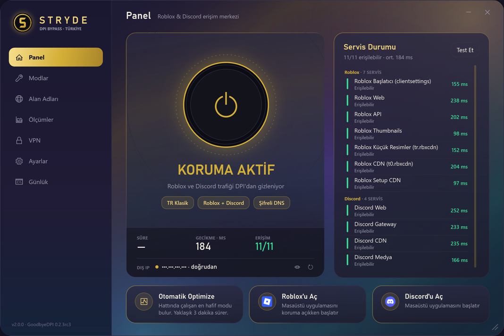

# Stryde

Türkiye'de Roblox ve Discord'a erişim engelini aşan ücretsiz bir Windows uygulaması.
Profil resimleri ve oyun görselleri yüklenir, indirme hızı düşmez.

**[Stryde'ı indir (StrydeSetup.exe)](https://github.com/Nestyyyyyy/stryde/releases/latest/download/StrydeSetup.exe)** · [Site](https://nestyyyyyy.github.io/stryde/) · [Tüm sürümler](https://github.com/Nestyyyyyy/stryde/releases)

## Ne yapar

- Roblox ve Discord'un 11 sunucusuna erişimi açar ve her birini 2 dakikada bir denetler.
- Roblox'un resim sunucularını çalışan adreslere yönlendirir, profil fotoğrafları boş kalmaz.
- Yalnızca Roblox ve Discord adreslerine dokunur. Diğer indirmeler olduğu gibi kalır.
- 7 modu senin hattında dener ve eksiksiz çalışan en hafifini seçer.
- Yeni sürümü kendisi kurar.
- Başka engelli siteler için isteğe bağlı Cloudflare WARP tüneli içerir.

## Hangi dosyayı indirmeliyim?

| Dosya | Kimin için |
|---|---|
| `StrydeSetup.exe` | Çoğu kişi için doğru seçim. Stryde'ı kurar. Bilgisayarda .NET 8 yoksa onu da Microsoft'tan indirir. |
| `Stryde-tam.zip` | Kurmak istemeyenler için. Hiçbir şey gerektirmez. Klasöre çıkar, `Stryde.exe` dosyasını çalıştır. |
| `Stryde.zip` | Kurmak istemeyenler için küçük paket. Bilgisayarda .NET 8 Desktop Runtime kurulu olmalı. |

Windows 10 ve 11, 64 bit.

## Uyarılar neden çıkıyor?

- **Windows "bilinmeyen yayıncı" der**, çünkü kurulum dosyasında dijital imza yok. "Ek bilgi" ve ardından "Yine de çalıştır" diyerek devam edebilirsin.
- **Antivirüs uyarı verebilir**, çünkü Stryde ağ paketlerini değiştirmek için WinDivert sürücüsünü kullanır. Bazı antivirüsler bu sürücüyü içeren her programı işaretler. Kaspersky ile çalışmaz.

Her sürümün dosya özetleri (SHA-256) sürüm notlarının altında yazar.

## Bu depo hakkında

Bu depo web sitesini ve resmi sürümleri barındırır. Motor olarak açık kaynaklı
[GoodbyeDPI](https://github.com/ValdikSS/GoodbyeDPI) ve [WinDivert](https://github.com/basil00/WinDivert) kullanılır.
Stryde'ın kendi kaynak kodu bu depoda yer almaz.

Uygulamanın eski adı Aura idi. Eski Aura kurulumları güncelleme ile kendiliğinden Stryde'a geçer.

## Sorun bildirmek

[Yeni bir sorun kaydı aç](https://github.com/Nestyyyyyy/stryde/issues/new?template=bug_report.md). Kayıtlar herkese açıktır,
tanı raporunu yapıştırırken IP adresini sildiğinden emin ol.

Roblox ve Discord kendi sahiplerinin markalarıdır, Stryde bu şirketlerle bağlantılı değildir. Kullanım sorumluluğu kullanıcıya aittir.
